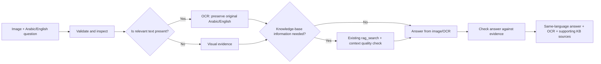

# Watira AI – Agentic RAG Knowledge Assistant

Watira AI is an Agentic Retrieval-Augmented Generation (RAG) application that answers questions from a document-based knowledge base and can perform actions through LLM tool calling.

The system uses Azure AI Search for document retrieval, Azure OpenAI for embeddings, answer generation, tool selection, and image/OCR analysis, Azure AI Speech for bilingual voice conversations, Flask for the backend API, and a web interface for chat interaction and evaluation.

## Architecture

```text
User Request
      ↓
Flask API
      ↓
Agent / Azure OpenAI
      ↓
LLM Tool Calling
      ↓
┌─────────────────────────────┐
│ rag_search                  │
│ calculator                  │
│ create_ticket               │
│ create_calendar_event       │
│ send_email                  │
└─────────────────────────────┘
      ↓
Multi-Step Tool Execution
      ↓
Grounded Final Answer
      ↓
Web Interface + Tool Trace
```

### RAG Retrieval Flow

```text
Word Documents
      ↓
Text Extraction
      ↓
Chunking
      ↓
Azure OpenAI Embeddings
      ↓
Azure AI Search Index
      ↓
rag_search
      ↓
Hybrid Search
(Keyword + Vector Search)
      ↓
Semantic Reranking
      ↓
Relevant Document Chunks
      ↓
Grounded Answer
```

## Features

- Agentic RAG architecture
- Azure OpenAI tool calling
- Automatic tool selection using the LLM
- Multi-step tool execution
- Retrieval-Augmented Generation (RAG)
- Word document indexing and chunking
- Azure OpenAI embeddings
- Azure AI Search vector retrieval
- Hybrid Search using keyword and vector search
- Semantic reranking
- Strict grounded answer generation
- Partial-answer handling when only part of a question is supported
- Protection against unsupported information
- Retrieved source and chunk inspection
- Hybrid and semantic ranking scores
- Tool execution trace
- TruLens RAG evaluation
- RAG Triad metrics
- Evaluation dashboard
- Responsive web interface
- Arabic and English speech recognition with automatic language identification
- Same-language neural text-to-speech responses
- Multi-turn voice conversation history
- Real-time barge-in that stops the active response when the user speaks
- Exactly eight voice-agent test scenarios with exportable actual results
- Image understanding and conditional Arabic/English OCR
- Image/OCR answers combined with existing RAG when needed
- Exactly eight image-agent fixtures with saved live evaluation results

## Image Understanding & OCR Agent

Open **Image & OCR Agent** in the sidebar, upload a JPEG/PNG/WEBP/static GIF
(up to 10 MB), and ask a question in Arabic or English. A vision-capable
Azure OpenAI deployment is required. `AZURE_OPENAI_VISION_DEPLOYMENT` is
optional; if empty, the existing `AZURE_OPENAI_DEPLOYMENT` is used.

`image_service.py` owns this task's image processing. The Flask endpoints stay
in `app.py`, the task prompts in `prompts.py`, and its eight evaluation cases
in `image_test_cases.py`. Original uploads are processed in a unique temporary
directory and removed after the request. Image bytes, dimensions and animation
are checked on the server; EXIF rotation is applied before analysis.
Normalized uploads are also capped at 10 MB. Small images remain lossless PNG;
large payloads use JPEG compression/resizing, which can affect tiny lettering.



The initial model decision uses **both the image and the question**. It reports
`VISUAL`, `OCR`, or `BOTH`, text presence, and whether KB retrieval is needed.
Text elsewhere in an image does not trigger OCR for a visual-only question.
OCR is implemented with the deployed vision model, not a separate Azure OCR
resource; the extracted text is returned separately from the answer.

For KB questions, the pipeline reuses the existing `rag_search` tool and
`check_retrieval_quality`. It accepts only sufficient context and only displays
KB sources selected from those chunks. A separate model check rejects answers
that cannot be supported by the available evidence. These model checks reduce
unsupported answers; they are not a mathematical guarantee of OCR accuracy.
Unreadable words are marked `[UNREADABLE]` and missing fields are not guessed.

The eight reproducible fixtures are in `static/image_test_cases/`. Run:

```powershell
venv\Scripts\python.exe -X utf8 evaluate_image_ocr.py
```

The runner records actual OCR, answers, modes, RAG use, limitations and latency
in `image_test_results.json`. Its checks are scenario-specific regression
checks; inspect the answers and OCR before presenting the results. The page
also lets you run each scenario, record a manual verdict and export results.

For a short demo: run the no-text image, English invoice, Arabic invoice,
mixed-language label, and image + KB example. Show the blurry and missing-field
cases to explain limitations. Test-case images contain synthetic data.

## Voice RAG Agent

The **Voice RAG Agent** is a separate demonstration page in the application. It uses the Azure Speech SDK in the browser for low-latency microphone recognition and speech playback while keeping the Speech subscription key on the Flask server.

```text
Microphone
    ↓
Azure Speech-to-Text + Arabic/English Language ID
    ↓
Agentic RAG + Conversation History
    ↓
Grounded Answer in the Detected Language
    ↓
Azure Text-to-Speech
    ↓
Speaker

User speech during playback
    ↓
Stop current audio immediately (Barge-In)
    ↓
Process and speak only the newest turn
```

The browser requests a short-lived Speech authorization token from `/speech-token`; the Azure Speech key is never returned to the browser. Continuous recognition stays active while TTS audio is playing. A partial recognition event immediately pauses the current audio, and the finalized utterance becomes the next agent turn.

The configured locales and voices are:

- Arabic: `ar-JO` with `ar-JO-SanaNeural`
- English: `en-US` with `en-US-JennyNeural`

For the most reliable barge-in demonstration, use headphones to prevent the microphone from recognizing speaker echo as an interruption.

## Agent Tools

The agent can automatically select and execute the following tools:

- `rag_search` – retrieves relevant information from the document knowledge base.
- `calculator` – performs mathematical calculations.
- `create_ticket` – simulates support ticket creation.
- `create_calendar_event` – simulates calendar event creation.
- `send_email` – simulates sending an email.

The ticket, calendar, and email tools are mock implementations for demonstration purposes and do not perform real external actions.

The agent can also combine multiple tools to complete multi-step requests.

## Knowledge Base

The application currently uses five Word documents covering:

- Moringa Tea
- Deep Learning
- Beginner Gardening
- Italian Coffee Culture
- Yoga

## RAG Evaluation

The project includes a RAG evaluation pipeline using TruLens.

The evaluation uses the RAG Triad:

- **Context Relevance** – measures how relevant the retrieved context is to the user's question.
- **Groundedness** – measures how well the generated answer is supported by the retrieved context.
- **Answer Relevance** – measures how relevant the generated answer is to the user's question.

Eight test cases are used to evaluate normal retrieval, partial knowledge, cross-document questions, and out-of-scope questions.

The web interface includes an evaluation dashboard that displays:

- Average RAG Triad scores
- Individual test-case scores
- Generated answers
- Retrieved chunks
- Per-chunk Context Relevance
- Hybrid Search scores
- Semantic Ranking scores

## Technologies

- Python
- Flask
- Azure AI Search
- Azure OpenAI
- OpenAI Python SDK
- TruLens
- python-docx
- HTML
- CSS
- JavaScript

## Project Structure

```text
Watira/
│
├── Documents/
│   ├── 1_Moringa_Tea_Health_Guide.docx
│   ├── 2_Deep_Learning_Basics.docx
│   ├── 3_Beginners_Guide_to_Gardening.docx
│   ├── 4_Italian_Coffee_Culture.docx
│   └── 5_Introduction_to_Yoga.docx
│
├── Templates/
│   └── index.html
│
├── static/
│   ├── style.css
│   └── script.js
│
├── app.py
├── agent_service.py
├── tools.py
├── search_service.py
├── evaluate_rag.py
├── upload_documents.py
├── clear_index.py
├── test_agent.py
├── requirements.txt
├── .env-example
├── .gitignore
└── README.md
```

## Environment Variables

Create a `.env` file based on `.env-example` and provide the required Azure credentials, deployment names, search service configuration, and index information.

The Voice RAG page additionally requires:

```text
AZURE_SPEECH_KEY=your-speech-resource-key
AZURE_SPEECH_REGION=your-speech-resource-region
```

Never commit API keys or other secrets to source control.

## Installation

Create and activate a Python virtual environment, then install the dependencies:

```bash
pip install -r requirements.txt
```

## Running the Application

Start the Flask application:

```bash
python app.py
```

Then open:

```text
http://127.0.0.1:5000
```

The web interface provides five main views:

- **Document Assistant** – interact with the Agentic RAG system and inspect tool execution.
- **RAG Evaluation** – run the TruLens evaluation and inspect RAG Triad results.
- **Adaptive RAG Evaluation** – inspect adaptive retrieval, rewriting, reranking, multi-hop retrieval, and grounded-answer metrics.
- **Voice RAG Agent** – run an Arabic/English voice session, test barge-in, and record the eight required live-test results.
- **Image & OCR Agent** – upload an image, inspect conditional OCR and RAG evidence, and run the eight image test scenarios.

The browser must be allowed to access the microphone. Localhost is accepted as a secure browser context; deployed versions should use HTTPS.

## Retrieval Strategy

The application uses Hybrid Search by combining:

1. Keyword search for lexical matches.
2. Vector search for semantic similarity.

Azure AI Search Semantic Ranking then reranks the retrieved results according to their relevance to the user's question.

The Hybrid Search score is a ranking score and should not be interpreted as a probability or percentage.

## Grounding

For knowledge-based questions, the agent is instructed to use `rag_search` and answer only with information explicitly supported by the retrieved context.

If only part of a question is supported, the system answers only the supported portion and identifies the information that could not be found.

The agent is instructed not to use outside knowledge to complete unsupported parts of an answer.

If no relevant information is available, the assistant responds:

> I could not find this information in the provided documents.

## Example

**Question:**

> What happens during training that does not happen during inference, and why does the model's behavior differ between them?

**Answer behavior:**

The system retrieves the available information about model training and answers only the supported portion. If the knowledge base does not contain information about inference, the assistant explicitly states that the missing information could not be found instead of completing the answer using outside knowledge.

This behavior helps reduce unsupported or hallucinated information.

## Author

Yazan
